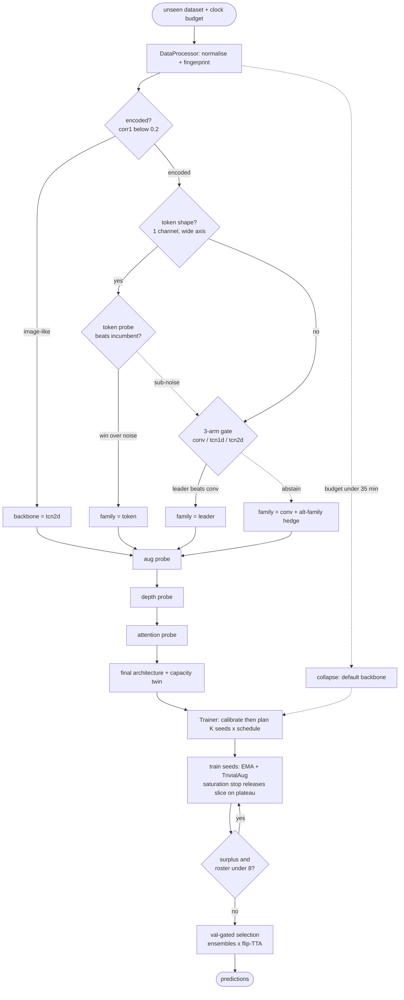

# HerriML — NAS Unseen-Data Challenge 2026

Team **HerriML**'s entry to the [5th NAS Unseen-Data Competition](https://www.nascompetition.com/)
at AutoML 2026. **3rd place.**

The challenge: build one Neural Architecture Search pipeline that is handed a completely
**unseen** image-classification dataset and a fixed time budget, and must process the data,
search an architecture, train it and return predictions, with **no per-dataset tuning and no
human in the loop**.

**Authors:** Luis Melzer · Sebastian Seifert · Leander von Gottberg
**Supervisors:** Dr. Marcel Wever · Prof. Dr. Marius Lindauer

This repository holds the final shipped pipeline (v13).

## Design principle: measure, gate, train

The pipeline never predicts which choice is better, it measures. Every stage runs a short *real*
training of each candidate at a matched budget, estimates the noise floor, and **adopts a
challenger only if it beats the incumbent by more than that noise**. Otherwise it abstains to the
default. Each decision, with its margin, is appended to a per-dataset record
(`<BASELINE_LOG_DIR>/<codename>_decisions.json`), so every run explains itself afterwards.

The whole search is budgeted in *fractions of the clock remaining at search start*, never in
absolute hours, so at a small budget the pipeline degrades gracefully to fingerprint plus default
backbone plus train-to-budget rather than overrunning.



Diamonds are runtime decisions. Dashed edges are the abstain-to-default and low-budget-collapse
routes.

### Search stages

1. **Fingerprint.** `DataProcessor` measures local pixel correlation on the raw tensors. A
   correlation decay below `corr1 = 0.2` flags *encoded* or symbolic data, where the image prior
   does not hold, and routes it away from the 2-D convolutional default.
2. **Backbone.** Image-like data takes TCN-2d directly, no bake-off. Encoded data goes through a
   token probe when its shape suggests one, otherwise a 3-arm gate (conv / tcn1d / tcn2d) at a
   matched short-train budget. The leader is adopted only if it clears the conv arm by more than
   the measured noise, otherwise the pipeline abstains to conv and hedges with an alternate family.
3. **Augmentation probe**, with arms matched to the chosen family.
4. **Depth**, as a default-incumbent search. The family default `D = 6` holds the position;
   candidates `{4, 8}` must beat it by more than noise at short-train *and* survive verification
   at a longer horizon.
5. **Attention probe**, encoded data only, and only if budget remains.

### Training

`Trainer` wraps an SGD warmup-plus-cosine recipe (EMA, label smoothing, NaN recovery,
`channels_last`) in a **throughput-keyed plan**: everything is derived from a short calibration of
measured step time, never from wall-clock hours or GPU names. It calibrates, projects epoch time,
chooses K seeds and a per-seed schedule, then re-plans after every seed from that seed's measured
duration, so one slow seed shrinks or drops the seeds behind it. A seed that reaches near-perfect
validation twice in a row stops early and donates its remaining slice. Selection is val-gated over
{each seed, ensemble} × {no-TTA, flip-TTA}, each extra validation pass clock-guarded, and
`predict()` degrades to single-best if the clock would not fit the ensemble and TTA passes.

## Results

- **Phase 2 grader:** clean pass on all three hidden datasets, no errors, well inside the limit.
- **Finals dress rehearsal at the Phase-3 operating point (~8 h/dataset):** GameOfLife 99.99 ·
  Windspeed 19.30 · **Cryptic 78.24**, ahead of the 2025 winning entry (76.15 on Cryptic) on all
  three datasets.
- **Competition:** 3rd place.

## The grader contract

The organisers' harness copies these four files next to its own `evaluation/main.py` and calls
them in sequence. File names and class signatures are fixed.

```
DataProcessor.process()         -> (train_loader, valid_loader, test_loader)
NAS.search()                    -> torch.nn.Module
Trainer.train()                 -> trained model
Trainer.predict(test_loader)    -> list[int]
```

A `clock` object is passed to every stage; the pipeline reads `clock.check()` and
`metadata["time_remaining"]` and adapts, hard-coding no wall-clock budget. Time, memory or shape
failures score −10. `requirements.txt` pins only `torch` and `numpy` (everything else is Python
stdlib) with loose ranges and no CUDA-suffixed wheels, so it resolves against the grader's driver.

| File | Role |
|------|------|
| `data_processor.py` | Normalisation, correlation-decay fingerprint, augmentation policy |
| `nas.py` | The measure-gate-train search pipeline and its budget allocation |
| `trainer.py` | Budget-adaptive training controller, seed planning, val-gated selection |
| `helpers.py` | Op vocabulary, CNN/TCN builders, augmentation policy, EMA, LR schedule |

## References

- [Starter kit](https://github.com/Towers-D/NAS-Comp-Starter-Kit) — the grader's `main.py` and `score.py`
- [Public datasets](https://github.com/Towers-D/NAS-Unseen-Datasets)
- [Competition site](https://www.nascompetition.com/)
